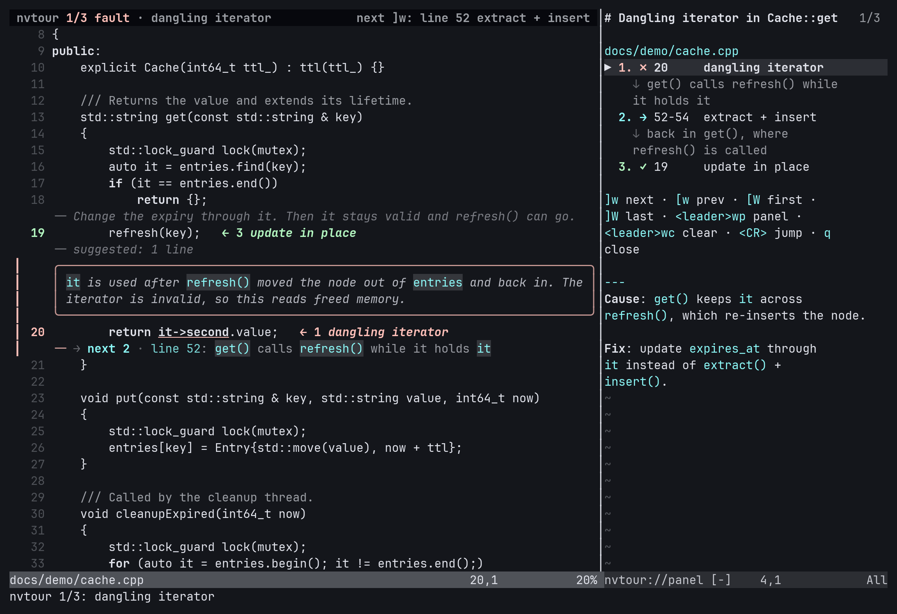

<div align="center">

# 🧭 nvtour

**Guided, read-only code walkthroughs in your running Neovim, driven by an AI agent.**

The agent explains a bug in chat. Your editor shows you where it is.


https://github.com/user-attachments/assets/5f05ea34-a360-4b4b-a2ca-6a5e6af5be51


</div>

---

## ✨ What it does

An agent (Claude Code, Codex, ...) explains a bug or a concept in chat and drives your **already-running**
Neovim in parallel. You step through the tour with `]w` / `[w`.

| | |
|---|---|
| 🎯 **Jump and highlight** | Moves to a range and marks it, without changing the colours of the code. |
| 📝 **Inline notes** | Attaches a note as virtual text, with `` `code` `` and `**bold**`. |
| 🔗 **Links between steps** | `--via` tells why the tour goes to a step. Each step shows where you came from, a change of file or version, and where `]w` goes next. |
| 🚦 **Roles** | Each step is a `fault`, `flow`, `fix`, `context` or `info`, each in its own colour. |
| 📋 **Step panel** | A side panel lists the steps by file, with a markdown summary. |
| 🔍 **Focus** | Folds or dims all code that is not related to the tour. |
| 🕰️ **Old code as a step** | `--ref GITREF` puts a step on a file as it is at a git ref, also a deleted file. |
| ✏️ **Suggested fix** | `--suggest` shows the code that would replace a range, below it, with syntax colours. The file does not change. |
| 🔀 **Read-only diffs** | Shows a file against a git ref, another file or stdin. |
| 🗺️ **Diagrams as steps** | Renders Mermaid or Graphviz to Unicode text above the code. Steps can point to its lines, and `<CR>` on a label opens the code. |
| ✅ **Self-checking ranges** | `--expect TEXT` stops a wrong line number before it shows the wrong code. |
| 🔎 **Ranges by text** | `FILE:/TEXT/` finds the lines by their text, so the agent does not count lines. |
| 📑 **Chapters** | `chapter "Name"` groups the steps of a long tour under headings. `]c` / `[c` move between chapters. |
| 📦 **A tour in one call** | `nvtour apply` reads a whole tour (steps, chapters, focus, diagrams, panel) from a TOML file on stdin. |
| 🔭 **Focus on the steps** | `focus --steps` folds every toured file to the lines of its steps. The folds follow the steps when they change. |
| 👀 **Follow and peek** | `<leader>wk` shows the full note and suggested code of the step under the cursor in a float, without leaving the current step. With `vim.g.nvtour_follow_cursor`, the step under the cursor becomes the current step. |
| 📌 **Marks from you** | `<leader>wm` marks the line or selection under the cursor. The agent reads your marks with `nvtour marks`. |
| ⚓ **Steps follow your edits** | When you edit a file during a tour, the steps move with the lines. `status` reports a step that moved or was lost. |

> [!IMPORTANT]
> **nvtour never writes to a file buffer or to a file you edit.** It writes only its own pin cache
> (`$XDG_RUNTIME_DIR/nvtour/`), and `instances --prune` removes stale nvim sockets. Plugins that react to
> window or buffer switches (auto-save, session savers) are outside this promise.

---

## 🚀 Quick start

```sh
pip install --user --break-system-packages -e ~/projects/nvtour

# Give the skill to your agent
ln -s ~/projects/nvtour/skill ~/.claude/skills/nvtour
ln -s ~/projects/nvtour/skill ~/.codex/skills/nvtour

# Check the setup
nvtour doctor
```

**Requirements:** Python ≥ 3.11 and Neovim ≥ 0.10. There are no Python dependencies.
Optional, for `nvtour diagram`: [`mermaid-ascii`](https://github.com/AlexanderGrooff/mermaid-ascii/releases)
(Mermaid) and `graph-easy` (`sudo apt install libgraph-easy-perl`, for Graphviz DOT).

**No nvim plugin is needed.** The Lua runtime is sent over RPC the first time a command runs, and again when
its version changes.

Then ask your agent to *"walk me through this bug in nvim"*.

---

## 🖼️ Anatomy of a tour



- **Current step:** a bar in the sign column along the range, the full note above it, and the `--expect`
  text underlined.
- **Every step:** coloured line numbers and an end-of-line marker `← N label`. The other steps also keep a
  one-line note.
- **The code itself never gets a background colour,** so syntax highlighting stays intact. The note of the
  current step is in a frame in the role colour, the lines start in the gutter, and the role bar goes from
  the note through the range, so they do not look like code.
- **Links:** `◇ b.cpp @origin/master (1a2b3c4d5e6f)` in the frame when the file or version changed, and
  below the range `╶─ → next 4 · c.cpp:10: <why>`. See [Links between steps](#links-between-steps).
- **Winbar:** the position in the tour (with the chapter name) and where `]w` goes next.
- **Panel:** the steps by file and chapter, the keys, and the summary.

### Roles

| role | marker | accent from | use it for |
|---|:---:|---|---|
| `fault`   | `✗` | `DiagnosticError` | the wrong line(s) |
| `flow`    | `→` | `DiagnosticInfo`  | how data or control gets there |
| `fix`     | `✓` | `DiagnosticOk`    | where or how it should change |
| `context` | `○` | `DiagnosticWarn`  | background |
| `info`    | `•` | `DiagnosticHint`  | neutral explanation (default) |

All roles at 1, 3 and 12 lines: **[dark](docs/roles-dark.png)** · **[light](docs/roles-light.png)**

---

## 🤖 Example: a 3-step bug walkthrough

This is what an agent runs:

```sh
nvtour attach
nvtour start "Dangling iterator in cleanup"

nvtour step src/a.cpp:412-415 --role fault --label "dangling iterator" --expect "it->second" \
    --note "The iterator is used after erase() invalidated it."

nvtour step src/b.cpp:88 --role flow --label "erase on cleanup thread" \
    --via 'the cleanup thread runs `evict()`' --note - <<'EOF'
The cleanup thread erases the entry while the reader still holds `it`.
EOF

nvtour step src/a.cpp:430 --role fix --label "copy before erase" --from 1 --via "back to the read"

nvtour panel - <<'EOF'
**Cause**: use after erase. **Fix**: copy the value before `erase()`.
EOF
```

An agent makes the same tour in one call with [`nvtour apply`](#tour-files-apply). How the steps behave:

- **Only the first step jumps.** The others are added without moving the view, so the finished tour is at
  step 1. `step --jump` forces a jump; `--no-jump` suppresses it for the first step too.
- **Each step prints the first highlighted line** so the agent can check it.
- **`--expect TEXT`** fails with exit 6 when `TEXT` is not in the range. In the current step, each occurrence
  of `TEXT` in the range is underlined in the role colour. Give it more than one time to mark several parts
  (`--expect 'refresh(key)' --expect 'it->second'`); each text must be in the range.
- **Notes are wrapped** to the window width. Two inline markdown forms are shown: `` `code` `` and
  `**bold**` (the markers are hidden).
- **A jump scrolls** so that the note and the range are in view: centred when they fit, else the note at the
  top, and never past the end of the file. The range flashes briefly after a jump.

### Tour files (`apply`)

For a tour of 3 steps or more, write the whole tour as a file and run it in one call. One call is faster
than many calls, and nothing is done when one step is wrong: the old tour stays as it was.

```sh
nvtour apply - <<'EOF'
title = "Dangling iterator in cleanup"
sheet = "arch"                        # optional, like start --sheet
panel = """
**Cause**: use after erase. **Fix**: copy the value before `erase()`.
"""

[[focus]]                             # optional, like nvtour focus
file = "src/a.cpp"
ranges = ["400-440", "/evict/../}/"]
dim = false
context = 2

[[diagram]]                           # optional, like nvtour diagram
name = "read"
format = "mermaid"                    # or: file = "docs/read.mmd"
source = """
sequenceDiagram
  C->>K: get
"""
links = ["get=src/cache.cpp:/Cache::get/+8"]
split = "above"

[[step]]
at = "src/a.cpp:/it->second/"        # FILE:L1[-L2] or any text range
role = "fault"
label = "dangling iterator"
note = "The iterator is used after `erase()` invalidated it."
expect = ["it->second"]              # list or one string
suggest = """
        it->second.expires_at += ttl;
"""                                  # string with new lines, or a list of lines
sheet = "#evict"                     # SHEET#STEP or #STEP
chapter = "The bug"                  # starts a chapter at this step

[[step]]
at = "src/a.cpp:/it->second/"
ref = "origin/master"                # optional: the file at a git ref (not with diagram)
role = "context"
label = "the old code"

[[step]]
at = "2"                             # with diagram: L1[-L2] or a text range of the diagram
diagram = "read"                     # optional: a step on a diagram (not with ref)
label = "the read"
via = "the cleanup thread runs `evict()`"
from = 1                             # optional: the link comes from step 1 (an earlier step)
EOF
```

- **The file** is TOML (`tomllib`), or JSON when the first character that is not white space is `{`. The
  JSON object has the same keys. nvtour never writes a tour file. `apply FILE` reads a file, and `apply -`
  (the default) reads stdin. Stdin from a terminal is exit 2.
- **The keys** of `[[focus]]`, `[[diagram]]` and `[[step]]` are the options of `focus`, `diagram` and `step`.
  `[[diagram]]` also takes `ascii`, `header` and `show` (`show = false` is `--no-show`), and needs one of
  `source` and `file`. A step must have `at`; a focus must have `file` and `ranges`. `ref` and `diagram` do
  not go together on one step. `suggest` and `expect` take a string or a list. A chapter is a key of the
  step (`chapter = "Name"`): there is no `[[chapter]]` table. The steps are added in the order of the file, so `at` is a location, not a number.
- **Unknown keys** and wrong types are exit 2, and the message names the entry. The entries are numbered
  from 1 in the order of the file: `step[3]: unknown key "lable" (did you mean "label"?)`.
- **All errors at once:** every entry is checked, also after an error, and one failure lists them all in
  file order (`3 errors, nothing was changed:` and one line per entry), so a tour file needs one fix, not
  one call per error. A step on a diagram that failed is not checked again.
- **Everything is checked first,** in nvim: files, ranges, text ranges, `expect`, `from`, sheet links,
  chapter names and the lines of diagram steps. A failure is exit 6 (or 2) with the entry in front, for
  example `step[4]: --expect "it->second" not found in src/a.cpp:402; line 402 is "..."; it is on line 405`. Nothing is
  changed: the old tour, its diagrams and its focus stay. (Buffers that were loaded stay loaded, as after a
  failed `step`.)
- **A new tour is the default.** `apply` does what `start` does, adds the diagrams, the focus, the steps and
  the panel text, and jumps to step 1. `--no-jump` leaves the view where it is.
- **`--append`** adds the steps to the current tour. The file has no `title` and no `sheet` then (exit 2).
  `from` is a step number of the final tour: the steps that are there come first, so the first new step is
  `steps + 1`. A new step can be on a diagram of the tour. `apply --append` jumps to the first new step,
  unless you give `--no-jump`.
- **`--check`** does all the checks and prints the resolved steps. It draws nothing and changes nothing.
- **Output:** the two lines of `step` for each step, then `panel: N lines`, `chapters: N` and
  `jumped to step 1`. With `--check` each step line starts with `ok ` and the last line is
  `check: N steps ok`. `--json` has `steps`, `total`, `panel_lines`, `chapters`, `jumped_to` and `current`.

### Ranges by text

Line numbers go wrong when the file changes. Name the code instead: `FILE:/TEXT/` is the line that
contains `TEXT` (plain text, not a regex).

```bash
nvtour step src/a.cpp:/Cache::get/ --label "the lookup"
nvtour step src/a.cpp:'/it->second = value/+2'     # that line and 2 lines after it
nvtour step src/a.cpp:'/void Cache::get/-3+8'      # 3 lines before it (a comment) to 8 lines after it
nvtour step src/a.cpp:/try/../catch/               # from the try line to the first catch line after it
nvtour step src/a.cpp:/erase/@2                    # the 2nd line that has "erase"
nvtour step src/a.cpp:/erase/~120                  # the line with "erase" that is nearest to line 120
```

| Form | Lines |
|---|---|
| `FILE:/TEXT/` | the line with `TEXT` |
| `FILE:/TEXT/+N` | that line and `N` lines after it |
| `FILE:/TEXT/-N` | `N` lines before that line, and the line (it stops at line 1) |
| `FILE:/TEXT/-N+M` | from `N` lines before it to `M` lines after it (`-N..+M` is the same) |
| `FILE:/START/../END/` | from the `START` line to the first `END` line at or after it |
| `FILE:/TEXT/@N` | the `N`-th line with `TEXT` (from 1) |
| `FILE:/TEXT/~L` | the line with `TEXT` that is nearest to line `L` (a tie: the earlier line) |
| `FILE:/TEXT/@N+2`, `FILE:/A/@2-1../B/+1` | the parts can be combined: `@N` or `~L` after `START`, then `-N`, `+N` at the end |

- **A slash in `TEXT`:** write `\/`. Other backslashes stay as they are.
- **A colon in `TEXT`** is fine (`a.cpp:/Cache::get/`). The text range starts at the first `:/` that is
  followed by a well formed `/TEXT/...`. Else the last `:` splits as before (`FILE:L1-L2`, `FILE:L:COL`).
- **Quotes:** a `TEXT` with spaces or shell characters needs quotes: `'a.cpp:/it->second = 1/'`.
- **Several lines have `TEXT`** and there is no `@N` or `~L`: exit 6. The message lists the lines
  (at most 10, with number and text), so you can choose with `@N` or `~L`.
- **No line has `TEXT`:** exit 6, `text 'TEXT' not found in FILE (N lines)`. `@N` with `N` more than the
  number of matches, or an `END` that is not found after `START`, is exit 6 too.
- **Where it works:** `step`, `edit` (the new location), `focus` (the first range and each extra range:
  `focus a.cpp:/try/../catch/ /cleanup/+3`), `diagram --link 'TEXT=FILE:/text/'`, and `step --diagram NAME
  /label/` (the text is searched in the rendered lines). Also with `--ref`: the text is searched in the
  file at that ref.
- **The result:** the CLI prints the lines it found, as for any step: `step 2/3: a.cpp:412-415 ...` and the
  first line. With `--json` the field `resolved_from` has the text range (`/Cache::get/`).
- The text is searched once, when the command runs. After that the step follows your edits like any step
  (see [Steps follow your edits](#steps-follow-your-edits)). `--expect` still checks the exact expression in the found lines.

### Chapters

A tour of more than 8 steps is easier to follow in groups. A chapter is a heading in front of a step. It
holds that step and the steps after it, up to the next chapter.

```bash
nvtour chapter "Why does it fail?"            # pending: the next step added starts the chapter
nvtour step src/cache.cpp:88 --label erase
nvtour step src/cache.cpp:120 --label race
nvtour chapter "How do we fix it?"
nvtour step src/cache.cpp:140 --label lock
nvtour chapter "Fixes" --at 2                 # a heading in front of step 2 (it exists already)
nvtour chapter --list
nvtour chapter --remove 2
```

- **`chapter "Name"`** is pending: the next step that is added starts the chapter, wherever that step is
  inserted (also with `step --at`). Only one chapter can be pending; a second name replaces the first.
- **`chapter "Name" --at N`** puts the heading in front of step N. `--at` equal to the number of steps + 1 is
  pending. A larger number is exit 6. If a chapter starts at step N already, the new name replaces the old
  name.
- **`chapter --remove N`** removes the chapter that starts at step N (the steps stay). With N equal to the
  number of steps + 1 it removes the pending chapter. `chapter --list` shows the chapters in tour order, and
  `status` shows them too (`--json`: `chapters = [{ name, step }]`, `step` is `null` when pending).
- **A chapter follows its step.** An insert or a `remove` of another step does not move the heading. When the
  step of a chapter is removed, the heading moves to the step that is now at that place. When there is no such
  step, or that step starts a chapter already, the chapter is dropped.
- **In the code** the first step of each chapter shows its name: a line `## Name` (group `NvtourPanelChapter`)
  is the first line above the note, before the `◇` and `↔ sheet` lines. A step that is not current shows the
  same line above its one-line note, so you see each chapter start while you scroll. A long name is cut with `…`,
  and the peek float shows the line too.
- **In the panel** a chapter is a line `## Name` (group `NvtourPanelChapter`) before its first step. The file
  name line starts again after it. The `↓ via` line of that step stays: it is after the heading and before the
  file name. `<CR>` on the line goes to the first step of the chapter. The progress
  text stays `3/12`.
- **In the winbar** the name is shown before the position: `Name · 3/12`. When the window is narrow, the
  name is the first part that is left out.
- **Keys:** `]c` goes to the first step of the next chapter. `[c` goes to the first step of the chapter that
  you are in. When you are at that step already, it goes to the chapter before. A chapter whose steps are
  all lost is skipped. In a window in diff mode, `]c` and `[c` keep the meaning of Vim (next or previous
  change). Without chapters they show `no chapters`.
- `step`, `goto` and the other commands print the same one line as before. `--json` has `chapter` (the name)
  for the step that is shown.
- `start` and `clear` remove all chapters.

### Steps follow your edits

You can edit a file while the tour is open. Each step on a file has an anchor (an extmark) over its lines,
so the step moves with the code. The range, the quickfix list, the panel and `]w` use the new lines.

- A line inserted above the range moves the step down. A line inserted inside it makes the range longer.
  A line added after its last line does not.
- If you delete all the lines of a step, the step is **lost**: it has no marks, the panel shows `✗ lost`,
  `goto N` fails with exit 6, and `]w` / `[w` skip it. Undo brings it back. To give it new lines:
  `nvtour edit N FILE:L1-L2`.
- `nvtour status` shows the current lines. A step that moved shows `(was 88-90)`, a lost step shows
  `(lost: reason)`, and a line `modified: a.cpp, b.cpp` names the files whose buffer differs from the disk.
  Line numbers from `rg` on disk can differ from the buffer in these files.
- After `:e!` (or a reload after a change on disk), the file on disk is the source. Each step is anchored
  again at its last lines. It is lost when those lines are beyond the end of the file or an `--expect` text
  is gone. Run `nvtour status` after files changed.
- A diagram step whose `--expect` text is gone after `diagram NAME` is lost too.
- Only anchors (extmarks) are used. The files and buffers are never changed.

### Follow and peek

Two user-side features help you read a tour at your own pace. Follow mode changes the current step when the
cursor moves. Peek shows one step in a float without a change of the current step.

**Follow the cursor.** Set `vim.g.nvtour_follow_cursor = true` (default off), or run `:NvtourFollow` to turn
it on and off. Then the step that holds your cursor becomes the current step. Its full note, the winbar, the panel, the quickfix
index and the linked sheet step follow. Nothing scrolls, nothing flashes, and no message is shown.

- Only normal-mode moves count (`CursorMoved`), after a pause of 100 ms. Moves in the panel do not count.
- When ranges are nested, the innermost one (the greatest first line) wins. A lost step is skipped.
- The cursor outside every step keeps the last current step.
- `]w` goes on from the step that you followed.
- A jump (`goto`, `]w`) puts the cursor on the first line of its step. That step stays current, also when
  a smaller step starts on the same line.
- `nvtour status` shows the line `follow: on` (`"follow": true` in `--json`), so an agent knows that the
  current step can change without a key.
- Default off, because the sheet viewer would jump each time the cursor crosses a step, and the note
  under the cursor would change while you edit.

**Peek at a step.** The note of a step that is not current is cut to one line. Press `<leader>wk` on a line
of such a step to read all of it. A float opens at the cursor with the full content of the step: the `◇` line (file and version),
the note with its `` `code` `` and `**bold**`, the suggested code with syntax colours in the `suggested`
frame, and the `→ next` line. The border has the colour of the role, and the title shows `N/T label`.

- The float closes when the cursor moves, when you leave the window or the buffer, with `<Esc>` or `q`,
  or when you press the key again. Only one float is open at a time.
- The step does not become the current step. The note under the code, the winbar, the panel and the sheet
  do not change. With the follow mode (above) on, the cursor still has to move to change the
  current step.
- When ranges are nested, the innermost step wins. A line without a step shows `nvtour: no step here`.
- `<Esc>` and `q` are mapped in the buffer only while the float is open. A buffer-local `<Esc>` or `q` of
  yours stays as it is, and the other key closes the float.
- In the panel, `K` on a step line peeks that step, at the panel cursor.
- `:NvtourPeek [N]` peeks step N (default: the step under the cursor). A number out of range gives a
  warning. A step that is lost has no lines in the code, so only the panel and `:NvtourPeek N` can peek it:
  the float then shows `✗ lost`.
- Diagram steps and steps at a git ref work in the same way.
- The float is as wide as the window text area (at most 100 cells), or `vim.g.nvtour_note_width`, and at
  most half as high as the window. In the panel it uses the width of the editor.
- The float shows a scratch buffer `nvtour://peek`. No file buffer is written.

### Animation

A jump to a step (`]w`, `goto`, the panel) is animated, so you see where the tour goes:

- **In the same file**, the view scrolls to the step (500 ms). A long way starts one window height before
  the step, so the scroll is never slow.
- **To another file**, the old text fades to the background, then the new text fades in (500 ms). The
  text of the two never mixes.
- **To the same file at another commit** (a step with `--ref`), the old version is lined up with the new
  one. The lines that are the same in both versions stay, and only the code that changed fades.
- **What changed** (a new chapter, a new file or commit) is shown where you read it, not over the code:
  - In the **inline view** the step shows it already (the chapter heading above the note, the change of
    file or version), so nothing more is drawn.
  - In the **side view** the lines of the card that changed light up: the chapter name, and the lines of
    the file and its version. A new chapter also lights up in the winbar. The light blinks (200 ms on,
    200 ms off) for 1500 ms each, and the code is there at once.
  - Only with the **card hidden** (`<leader>ws`) does the fade show a title card in the middle: the chapter
    name and `◇ file @ref (sha)`. The fade stays dark while it shows (1500 ms for each line), and a new
    chapter in the same file fades too (with only its name), instead of the scroll.
- The flash of the range comes after the animation.

`<leader>wa` or `:NvtourAnimate [on|off|toggle]` turns it on and off. `vim.g.nvtour_animate = false` turns it
off in `init.lua`. When it is not set, it is on when Neovim has a UI, and off in a headless Neovim.

- The step, the panel, the quickfix index and the card change at once; only the view moves. Any key, the
  next jump, or a command from the agent ends the animation at once at the final view.
- The fade needs `termguicolors`. Without it, a jump to another file is not animated.
- During the first half of a fade the old buffer is shown again, read-only, under a blank float
  (`nvtour://fade`). A key that you type then cannot change it.
- Set `vim.g.nvtour_scroll_ms`, `vim.g.nvtour_fade_ms`, `vim.g.nvtour_title_ms` (the chapter: its light in
  the card, or its line on the title card) and `vim.g.nvtour_file_ms` (the file and version) to change the
  durations. `0` turns that one off; without the chapter line, a new chapter in the same file scrolls.

### Side view

The notes, links and markers between the lines of code can feel cluttered. The side view moves all of it into
a step card on the left. Press `<leader>wv` (or `:NvtourView`) to switch between the two views, or start in
the side view with `vim.g.nvtour_view = "side"`.

The card shows the current step:

```
1/3 ✗ fault · Why does it fail?            position, role, chapter
dangling iterator                          label
docs/demo/cache.cpp:20                     file and lines
working tree · master @ 0c1af94a27e3       the version: the working tree on a branch and its commit
repo nvtour                                the repository ("worktree NAME" in a linked worktree)
↔ arch#3                                   sheet link
↑ from 2: get() calls refresh() …          how the tour came here (--via, --from)
────────────────────────────
<the note, as markdown>
Watch                                      the --expect texts, one per line
• it->second
────────────────────────────
Next  ]w                                   where ]w goes:
2 → extract + insert                       the number, role mark and label of the next step
line 52                                    where it is
↓ get() calls refresh() while it holds it  why the tour goes there (its --via)

Previous  [w
first step
```

A step at a git ref shows `git ref v1 · <commit>` (or `commit <sha>` when the ref is a hash) instead of the
working tree. `<CR>` on the Next or Previous block goes to that
step. `<leader>ws` (or `:NvtourCard`) hides and shows the card, as `<leader>wp` does for the panel; `q` in
the card hides it too. A hidden card keeps the side view, so the code stays clean; `<leader>wv` goes back to
the inline view.

In the code, every step keeps its coloured line numbers. The current step also keeps its suggested code (the
`suggested` frame and the struck-through lines) and the underlined `--expect` texts (the Watch list of the
card), and gets a **range style**:

| style | what it draws |
|---|---|
| `rules` (default) | a line above the range with the step number, role mark and label, and a line below it |
| `bracket` | `┌ │ └` beside the line numbers. Takes no extra lines |
| `spotlight` | dims every line outside the range |

Join styles with `+`, for example `rules+spotlight`. `<leader>wr` goes to the next style and turns the side
view on. It goes through `rules`, `bracket`, `spotlight` and `rules+spotlight`, so you can compare them on
a live tour. `:NvtourRangeStyle bracket` picks one, and `vim.g.nvtour_range_style` sets
the default. `nvtour status` shows `view: side (STYLE)`.

The winbar, the panel, the quickfix list and peek work as in the inline view.

### Marks

You can point at code for the agent. Put the cursor on a line (or select lines or text) and press `<leader>wm`.
A `◆` sign shows the mark, and nvim says `nvtour: mark 2 added (a.cpp:88-90)`. Press `<leader>wM` to add a
comment too: nvim asks `Note for the agent:`. An empty or cancelled input keeps the mark without a comment.

The agent reads the marks with `nvtour marks`. The output looks like `where`:

```
1. src/a.cpp:88-90  (2 min ago)  "why is this not under the lock?"
     cache.erase(key);
     ...
2. src/b.cpp:12  @origin/master  (1 min ago)
```

- A mark has the file, the range, the text, the time, and the comment if there is one. In a step at a git
  ref, it has the ref and the commit (`@REF` in the output). In a diagram, the output shows `diagram NAME`.
- **Text:** the saved text is at most 200 lines and 64 KiB, like `where`. The text output shows the first 5
  lines of a mark, then `...`. `--json` has all the text. The text is the text at the time of the mark.
- **Selection:** in visual mode (character, line or block), the mark covers the selected lines, and the text
  is the selected text. In normal mode it is the cursor line.
- **Sign:** the `◆` is on the first line of the range (`NvtourUserMark`, links to `DiagnosticHint`).
- **Edits:** the mark follows your edits, like a step. If you delete all its lines, the output shows
  `(lines deleted)` with the last range and the saved text. An undo brings the lines back.
- `nvtour marks --clear` prints the marks and removes them, signs too. It removes exactly what it prints.
  `:NvtourMarksClear` removes them too.
- `nvtour marks --wait SECONDS` waits until there is at least one mark (it checks every 0.5 s). After
  `SECONDS` without a mark it is exit 6: `no marks after S s`. With `--clear`, it clears only what it printed.
  Without `--wait`, no marks gives `no marks` (exit 0). Each check is a short call inside `--timeout`, so a
  nvim that waits at a prompt is still found (exit 5).
- **The marks are yours.** `start` and `clear` keep them, and so do the mark keys. Only `marks --clear` and
  `:NvtourMarksClear` remove them. They live in the nvim process only: they are gone when nvim exits.
- The mark keys are installed when nvtour loads in nvim (any `nvtour` command, also `attach`), not when a tour
  starts. The key rules are the same as for the other keys (free keys only, one warning). They work in normal
  and visual mode. Change them with `mark` and `mark_note` in `vim.g.nvtour_keys`.
- While the `Note for the agent:` prompt is open, nvim waits for you and agent commands fail with exit 5.
  The agent can retry after you answer.
- `nvtour status` shows `marks: N` (`"marks": N` in `--json`; the text line only when N is more than 0).
- A mark never writes a file buffer.

### Focus on the steps

After a long tour in long files, run one command: `nvtour focus --steps [FILE] [--context N] [--dim]`.
It folds (or, with `--dim`, dims) every toured file to the lines of its steps, plus `N` lines of context
(default 2). With `FILE` it does only that file. The view does not move.

- The focus **follows the steps**. When you add, edit, remove or move a step (also with an edit of the
  file by you), the folds are made again. When the last step of a file is gone or lost, the focus of that
  file ends.
- A file that gets its first step later is not focused. Run `focus --steps` again to include it.
- Diagram steps and lost steps do not count. A step at a git ref focuses its read-only buffer.
- `nvtour focus FILE:L1-L2` on a file replaces its focus from the steps. `unfocus [FILE]`, `start` and
  `clear` end it.
- The output has one line per file: `focus: a.cpp 9-13 29-31 (fold)`. `status` adds `from steps`:
  `(fold, from steps)`. In JSON, `focus --steps` returns `{"ok": true, "focus": [...]}`: one entry per file.
- Exit 6 when no step is in the tour or in `FILE`. Exit 2 when you give a range with `--steps`.
- Fold mode removes manual folds in the window of the file. Use `--dim` if you have manual folds.

### Links between steps

A jump to another file, or to another version of the same file, loses the context: why the tour goes
there, and where you are. The current step shows both:

```
     ╭──────────────────────────────────────────────╮
   ▎ │ ◇ b.cpp @origin/master (1a2b3c4d5e6f)         │  ← the file and version (when they changed)
   ▎ │ The cleanup thread erases the entry ...       │  ← the note
     ╰──────────────────────────────────────────────╯
88 ▎   cache.erase(key);
   ▎ ╶─ → next 4 · c.cpp:10: the reader uses `it` again  ← where ]w goes, and why
```

- **`--via TEXT`** is the link to a step: why the tour goes there from the step before it. `--from N` makes
  the link come from step N (for example back to step 1); the "next" line then shows `(from N)`. A link to a
  removed step falls back to the step before it.
- **The `◇` line** is shown when the file or the version changed: the file, and `@ref (commit)` for a step at
  a git ref, or `working tree` when the step before was at a git ref.
- **The "next" line** below the range is shown when the next step is in another file or version, or has a
  `--via` link. You know where `]w` goes, and why, before you press it.
- **In the panel,** each link is a line `↓ [from N: ]text` before the step, so the panel reads as a chain.
- **Jumplist:** each jump adds the previous position to the jumplist, so `<C-o>` goes back.

### Sheets

When the agent also draws a canvas with [`sheet`](https://github.com/ClickHouse/agentsheet), a tour step can
show a step of that sheet. The sheet moves when the step becomes the current step:

```
nvtour start "Cache bug" --sheet arch
nvtour step cache.cpp:88 --note 'The entry is erased here.' --sheet '#evict'   # sheet "arch", step id "evict"
nvtour step reader.cpp:10 --sheet other#3                                      # another sheet, step 3
nvtour edit 2 --sheet ''                                                        # remove the link
```

- **`--sheet SHEET#STEP`** (on `step` and `edit`): STEP is a number (0 is the overview) or a step id. Prefer step
  ids: numbers change when the sheet changes. `#STEP` uses the sheet of `start --sheet`. A value without `#` is
  exit 2.
- nvtour only runs `sheet goto -q --no-autostart SHEET STEP`, detached and 150 ms after the step became
  current (the last step wins, so holding `]w` runs one process). It never starts a viewer. When `sheet` is
  not on `PATH` (or `vim.g.nvtour_sheet_cmd` is not executable), nothing happens; `nvtour doctor` tells you.
- The step line, `status` (`sheet` in `--json`) and the panel show `↔ sheet SHEET#STEP`.
- The first linked step, and a step that goes to another sheet than the linked step before it, start their note
  with `↔ sheet SHEET`, as the `◇` line does for another file.
- `SHEET_SOCKET` and `SHEET_HOME` from the environment of the `nvtour` command are stored with the link and
  used for the `sheet` call, so a forward (`SHEET_SOCKET=tcp://127.0.0.1:PORT`) works even when Neovim was
  started without it. Without them, Neovim's own environment is used.

### Suggested fix

`--suggest TEXT|-` shows the code that would replace the range of a step. Use it on a `fix` step:

```sh
nvtour step src/cache.cpp:19-20 --role fix --label "update in place" --suggest - <<'EOF'
        it->second.expires_at += ttl;
        return it->second.value;
EOF
```

```
19 ▎     r̶e̶f̶r̶e̶s̶h̶(̶k̶e̶y̶)̶;̶                 ← the lines that the suggestion replaces: struck through
20 ▎     r̶e̶t̶u̶r̶n̶ ̶i̶t̶-̶>̶s̶e̶c̶o̶n̶d̶.̶v̶a̶l̶u̶e̶;̶
   ▎ ╭ suggested ─────────────────────────────╮
   ▎ │ +   it->second.expires_at += ttl;        │  ← the new code, in the column of the old code
   ▎ │ +   return it->second.value;             │
   ▎ ╰──────────────────────────────────────────╯
```

- **Only virtual lines.** The file and the buffer do not change.
- **Syntax colours** come from treesitter, in the language of the file. Without a parser the code is plain.
- **The indentation** is the indentation of the file. Up to 4 cells of it go, so the new code is in the
  column of the code that it replaces. A line wider than the window is cut with `…`.
- **The other steps** show only one line: `╶─ suggested: 2 lines`.
- `edit N --suggest TEXT|-` changes it, `--suggest ''` removes it. Only one of `--note` and `--suggest` can
  read stdin.
- For a change that is larger than one range, use `nvtour diff`.

### Old code as a step

`--ref GITREF` puts a step on the file as it is at a git ref, not on the working tree. Use it for code that a
change removed or moved, or to show the old version of a range and then the new one:

```sh
nvtour step src/cache.cpp:16-20 --ref origin/master --role fault --label "refresh before the check"
nvtour step src/cache.cpp:16-21 --role fix --label "check end() first"
```

- The old version opens in a read-only scratch buffer `nvtour://origin/master/src/cache.cpp`, with the
  syntax highlighting of the file. Notes, roles, `--expect`, the panel and the keys work as on any step.
- The step is bound to the commit that the ref points to when the step is added, so a ref that moves later
  does not change it. The file does not have to exist in the working tree.
- The winbar shows `@origin/master`, and the panel groups the step under `src/cache.cpp @origin/master`.
- The buffer has `b:nvtour_ref` (`{ ref, sha, file }`). `clear` deletes it.

### Diagrams

A concept is often easier to see as a picture. The terminal cannot show images, so `nvtour diagram` renders
the diagram to Unicode text in a read-only buffer, in a split above the code. Steps can point to its lines:

```sh
nvtour diagram read --link 'get=src/cache.cpp:12-20' --link 'load=src/cache.cpp:31-38' <<'EOF'
sequenceDiagram
    participant C as Client
    participant K as Cache
    participant S as Store
    C->>K: get
    K->>S: load
    S-->>K: value
    K-->>C: value
EOF
nvtour step --diagram read 8-9 --role flow --label "load on a miss" --expect load
nvtour step src/cache.cpp:31-38 --label "load from the store" --via 'a miss calls `load()`'
```

```
┌────────┐     ┌───────┐     ┌───────┐
│ Client │     │ Cache │     │ Store │
└────┬───┘     └───┬───┘     └───┬───┘
     │             │             │
     │ get         │             │
     ├────────────►│             │
     │             │             │
     │             │ load        │
     │             ├────────────►│
     │             │             │
     │             │ value       │
     │             │◄┈┈┈┈┈┈┈┈┈┈┈┈┤
```

- **Formats:** `mermaid` (flowcharts and sequence diagrams, through `mermaid-ascii`), `dot` and `easy`
  (Graphviz DOT and Graph::Easy syntax, through `graph-easy`), and `text` (a diagram drawn by hand). The
  default comes from the file extension (`.mmd`, `.dot`, `.gv`, `.txt`), else mermaid. `--ascii` draws
  `+-|` lines. `$NVTOUR_MERMAID_ASCII` and `$NVTOUR_GRAPH_EASY` can give the renderer command.
- **The output** names the size and prints every line with its number, so the agent can pick the lines of
  a step.
- **Steps on a diagram** (`step --diagram NAME L1[-L2]`) work as on a file: notes, roles, `--expect`,
  `--via`, the panel and the keys. `]w` goes from the diagram to the code and back. Code steps never use
  the diagram window, so the diagram stays in view above the code.
- **Links:** `--link TEXT=FILE:L1[-L2]` (or `TEXT=FILE:/text/`) underlines TEXT. `<CR>` on it opens the range in the code window;
  `<C-o>` goes back. TEXT must be in the diagram and the range in the file, else exit 6.
- **Window:** by default a split above the code, as high as the diagram (at most 60 % of the code
  window). `--split above|below|left|right` puts it on another side; left or right, the code and the
  diagram share the width equally, also when the panel opens or closes. `--split full` opens the diagram in a tab page of its own, so it fills the screen; `<CR>` on a link and `]w` go back to the code tab. A diagram window on another side moves. Later diagram windows, also
  the one that `]w` opens again, use the last `--split` until `start` or `clear`.
- **Header line:** the participant names of a Mermaid sequence diagram stay in the winbar of the
  diagram window when they scroll out of view, above their lifelines, also when you scroll sideways.
  `--header N` makes line N the header line of any diagram, `--header 0` turns it off. The code window
  keeps the tour position in its winbar.
- `diagram` again with the same name replaces the lines. `--no-show` does not open the window. `clear` and
  `start` delete the diagrams, so make them after `start`.

---

## 📖 Command reference

**Instances**

| command | what it does |
|---|---|
| `attach [PID\|SOCKET]`, `attach --clear` | select and pin an instance |
| `instances [--prune]` | list instances (`live`, `stale`, `unresponsive`, `blocked`) |
| `doctor` | check the setup |

**Building a tour**

| command | what it does |
|---|---|
| `start [TITLE] [--sheet SHEET]` | start a new tour (keeps an open panel); `--sheet`: the sheet of the tour |
| `step FILE:L1[-L2]\|FILE:/TEXT/ [--ref GITREF] [--note TEXT\|-] [--label] [--role] [--expect TEXT]... [--via TEXT] [--from N] [--suggest TEXT\|-] [--at N] [--sheet SHEET#STEP] [--jump\|--no-jump]` | add a step (`--ref`: on the file at that git ref; `--via`: why the tour goes there from the step before, or from step `--from N`; `--suggest`: the code that would replace the range; `--sheet`: show that step of a [sheet](#sheets) when the step becomes current) |
| `edit N [FILE:L1[-L2]\|FILE:/TEXT/ [--ref GITREF]] [--note] [--label] [--role] [--expect] [--via] [--from N] [--suggest] [--sheet SHEET#STEP] [--jump]` | change a step (`''` removes a label, note, link text, suggestion, sheet link or the `--expect` texts; a new `--expect` list replaces the old one; `--from 0` links from the step before again; a new location without `--ref` is on the working tree) |
| `step L1[-L2] --diagram NAME [...]`, `edit N L1[-L2] --diagram NAME` | a step on lines of a diagram |
| `remove N` | remove a step |
| `apply [FILE\|-] [--append] [--check] [--no-jump]` | a whole tour from a TOML or JSON file: a new tour by default; `--append` adds to the current tour; `--check` only checks (see [Tour files](#tour-files-apply)) |
| `chapter "NAME" [--at N]`, `chapter --remove N`, `chapter --list` | a heading in front of step N, or of the next step added; remove one; list them (see [Chapters](#chapters)) |
| `panel [TEXT\|-\|--file PATH] [--toggle] [--clear]` | side panel text |

**Navigation and state**

| command | what it does |
|---|---|
| `goto N`, `next`, `prev`, `first`, `last` | navigate (a lost step: `goto` is exit 6, the others skip it) |
| `status` | the tour, focus, panel, diff tabs and installed keys; chapters; steps that moved `(was L1-L2)` or are lost `(lost)`; `modified:` files; `follow: on` and `marks: N` when they apply |
| `where` | cursor, live or previous selection (exact text), visible range of the user's file window |
| `marks [--wait SECONDS] [--clear]` | the places that the user marked with `<leader>wm`; `--wait`: wait for a mark (exit 6 after the time); `--clear`: remove what is printed (see [Marks](#marks)) |

**View**

| command | what it does |
|---|---|
| `focus FILE:L1-L2 [L3-L4 ...] [--context N] [--dim]` (a range can be `/TEXT/` too), `unfocus [FILE]` | fold or dim the rest of a file |
| `focus --steps [FILE] [--context N] [--dim]` | fold or dim every toured file (or FILE) to the lines of its steps; the focus follows the steps (see [Focus on the steps](#focus-on-the-steps)) |
| `diff FILE (--ref REF\|--file PATH\|--stdin) [--title]`, `diff-close` | read-only diff tab |
| `diagram NAME [FILE\|-] [--format mermaid\|dot\|easy\|text] [--link TEXT=FILE:L1[-L2]\|FILE:/text/]... [--ascii] [--header N] [--split SIDE] [--no-show]` | render a diagram above the code (see [Diagrams](#diagrams)) |
| `clear [--keep-buffers]` | remove everything nvtour created |

**Ranges:** `FILE:L1`, `FILE:L1-L2`, `FILE:L1,L2` and `FILE:L:COL` (the column is ignored, so compiler and
`rg --column` output works as is). By text: `FILE:/TEXT/`, `FILE:/TEXT/+N`, `FILE:/START/../END/`,
`FILE:/TEXT/@N`, `FILE:/TEXT/~L` (see [Ranges by text](#ranges-by-text)).

**Global flags:** `--json`, `--socket PATH`, `--workspace DIR`, `--timeout SECONDS`. They are also accepted
after the subcommand.

---

## ⌨️ Keys

Default keys are set only if they are free. If a key is already mapped, a warning is shown once and the key
is skipped. The tour keys are set when a tour starts and removed by `clear`. The mark keys (`<leader>wm`,
`<leader>wM`) are set when nvtour loads in nvim and stay.

| key | action |
|---|---|
| `]w` / `[w` | next / previous step |
| `]W` / `[W` | last / first step |
| `]c` / `[c` | first step of the next chapter / of this chapter (or the one before) |
| `<leader>wp` | toggle panel |
| `<leader>wk` | peek at the step under the cursor in a float (see [Peek at a step](#follow-and-peek)) |
| `<leader>wv` | switch between the inline view and the [side view](#side-view) |
| `<leader>ws` | hide / show the step card of the side view (turns the side view on) |
| `<leader>wr` | next range style of the side view (turns the side view on) |
| `<leader>wa` | turn the [animation](#animation) of jumps on or off |
| `<leader>wm` / `<leader>wM` | mark the cursor line or the selection for the agent / the same, then ask for a comment (see [Marks](#marks)); normal and visual mode; always installed, also without a tour |
| `<leader>wc` | clear everything |

**In the panel:** `<CR>` jumps to the step under the cursor (on a chapter line, a file name or a link line: the
step after it), `K` peeks at that step, `q` closes the panel.

**In the step card:** `<CR>` on the Next or Previous block goes to that step, `q` hides the card.

**In a diagram:** `<CR>` on an underlined link text opens its code; elsewhere it moves down as usual.

**Commands:** `:NvtourNext`, `:NvtourPrev`, `:NvtourFirst`, `:NvtourLast`, `:NvtourNextChapter`,
`:NvtourPrevChapter`, `:NvtourGoto N`, `:NvtourPanel`, `:NvtourClear`, `:NvtourPeek [N]` (see
[Peek at a step](#follow-and-peek)), `:NvtourFollow` (turn [follow mode](#follow-and-peek) on or off),
`:NvtourView [inline|side|toggle]`, `:NvtourCard`, `:NvtourRangeStyle [STYLE]` (see [Side view](#side-view)),
`:NvtourAnimate [on|off|toggle]` (see [Animation](#animation)), `:NvtourMarksClear` (remove all [marks](#marks)).

**Quickfix:** the list `nvtour: <title>` works too (`:cnext`, `:cprev`), but it only moves the cursor. It does
not change the current step of the tour.

---

## ⚙️ Configuration

Set these in `init.lua` before the first step:

```lua
vim.g.nvtour_keys = { next = "]w", prev = "[w", first = "[W", last = "]W", panel = "<leader>wp", clear = "<leader>wc",
                      next_chapter = "]c", prev_chapter = "[c", peek = "<leader>wk",
                      view = "<leader>wv", card = "<leader>ws", range_style = "<leader>wr",
                      animate = "<leader>wa", mark = "<leader>wm", mark_note = "<leader>wM" }
vim.g.nvtour_auto_panel = false               -- do not open the panel on the first step
vim.g.nvtour_steal_focus = "unless_terminal"  -- "always" | "never"; default keeps the focus in a terminal window
vim.g.nvtour_winbar = false                   -- do not show the tour position in the winbar of the tour window
vim.g.nvtour_flash = 0                        -- ms the range flashes after a jump (default 300; 0 = off)
vim.g.nvtour_animate = false                  -- no animation of jumps (default: on when nvim has a UI)
vim.g.nvtour_scroll_ms = 500                  -- ms of the scroll in the same file (default 500; 0 = off)
vim.g.nvtour_fade_ms = 500                    -- ms of the fade to another file (default 500; 0 = off)
vim.g.nvtour_title_ms = 1500                  -- ms a new chapter is lit in the card / on the title card (default 1500; 0 = off)
vim.g.nvtour_file_ms = 1500                   -- ms a new file or version is lit / on the title card (default 1500; 0 = off)
vim.g.nvtour_follow_cursor = true             -- the step under the cursor becomes the current step (default false)
vim.g.nvtour_note_style = "band"              -- a background band instead of the frame (default "frame")
vim.g.nvtour_note_width = 160                 -- wrap notes at most this many cells wide (default: the window width)
vim.g.nvtour_view = "side"                    -- the step card on the left instead of notes in the code (default "inline")
vim.g.nvtour_range_style = "rules+spotlight"  -- how the side view marks the range (default "rules")
vim.g.nvtour_sheet_cmd = "sheet"              -- the command for steps with --sheet (default "sheet")
```

- **Winbar:** set only in a window that has no winbar of its own (from you or a plugin). `clear` removes it.
  When the window is narrow, the "next" part is shortened or left out, and the chapter name goes first.
- **Windows:** files are shown in a normal file window, never in a terminal, quickfix, help or other special
  window. When you type in a terminal window (for example a Claude Code split), the tour moves the file window
  but the terminal keeps the focus.

<details>
<summary><b>🎨 Highlight groups</b></summary>

<br>

Each role takes its accent colour from the colorscheme (see [Roles](#roles)). The range has no background,
so syntax highlighting stays intact.

In the names below, `{...}` is one of `Fault`, `Flow`, `Fix`, `Context`, `Info`.

| group | used for |
|---|---|
| `NvtourNumber{...}` | line numbers of the range |
| `NvtourSign{...}` | the bar, the step number in the end-of-line marker, the panel and the winbar |
| `NvtourLabel{...}` | end-of-line label |
| `NvtourMark{...}` | the `--expect` texts |
| `NvtourStrike`, `NvtourSuggest` | the lines that a suggestion replaces, suggested code without a syntax group |
| `NvtourNote`, `NvtourNoteCode`, `NvtourNoteBold` | the note of the current step |
| `NvtourNoteCollapsed` | one-line note of the other steps |
| `NvtourNoteBorder` | note border |
| `NvtourVia`, `NvtourViaLoc`, `NvtourVersion` | link text, link location, version (`@ref`, `working tree`) |
| `NvtourFrame{...}` | the frame around the note, the `╶─` lead of the "next" line, the rules of the side view |
| `NvtourNoteBg` | the band behind all nvtour lines (`nvtour_note_style = "band"`) |
| `NvtourDim`, `NvtourFlash` | `focus --dim` and the `spotlight` range style, the flash after a jump |
| `NvtourDiagramLine`, `NvtourDiagramLink` | the box and arrow characters of a diagram, the underlined link texts |
| `NvtourPanelCurrent`, `NvtourPanelFile`, `NvtourPanelProgress` | panel |
| `NvtourCardTitle` | the label in the step card of the side view |
| `NvtourPanelChapter` | the `## Name` line of a chapter in the panel, and the name in the winbar (links to `Title`) |
| `NvtourLost` | `✗ lost` of a step whose lines were deleted (links to `DiagnosticError`) |
| `NvtourUserMark` | the `◆` sign of a mark of the user (links to `DiagnosticHint`) |

The groups are defined with `default = true`, so a plain `vim.api.nvim_set_hl(0, "NvtourSignFault", {...})`
in `init.lua` wins on first load. To survive colorscheme changes and runtime upgrades, set overrides in an
autocmd:

```lua
vim.api.nvim_create_autocmd("User", {
  pattern = "NvtourHighlights",
  callback = function() vim.api.nvim_set_hl(0, "NvtourSignFault", { fg = "#ff5555", bold = true }) end,
})
```

</details>

---

## 🚪 Exit codes

| code | meaning |
|:---:|---|
| `0` | ok |
| `2` | usage error (also a bad tour file, an unknown key in it, or a range with `focus --steps`) |
| `3` | no unique matching nvim (table of live instances on stderr) |
| `4` | no live nvim at all, or the `--socket` path does not exist |
| `5` | RPC failure or timeout; `waiting for input` means nvim is at a prompt and nothing ran |
| `6` | bad file, range, text range or `--expect` (also `goto` on a lost step, or a failed entry of `apply`: `step[4]: ...`); `marks --wait`: `no marks after S s` |

With `--json`, errors are printed on stdout too: `{"ok": false, "code": N, "error": "..."}`. Warnings (for
example a key that is already mapped) are in the `warnings` list, or on stderr as `warning: ...`.

---

## 🔌 How nvtour finds your Neovim

**Socket precedence:**

```
--socket PATH  →  $NVTOUR_SOCKET  →  $NVIM  →  pinned socket for the workspace (if alive)  →  discovery
```

**Discovery** scans `$XDG_RUNTIME_DIR/nvim.*.0`, `/tmp/nvim.$USER/*/nvim.*.0` and `/tmp/nvim.*.0` (probed in
parallel):

- sockets whose pid is gone or belongs to another program are `stale`;
- sockets that fail a 2 s probe are `unresponsive`;
- an nvim at a prompt is `blocked`.

The workspace `W` is `--workspace`, else the git toplevel of the cwd (in a submodule: of its outermost superproject), else the cwd. Each live instance gets a
score:

| condition | score |
|---|:---:|
| nvim cwd == `W` | 100 |
| `W` is an ancestor of nvim cwd | 80 |
| nvim cwd is an ancestor of `W` | 60 |
| otherwise, a listed buffer is under `W` | 40 |
| none | 0 |

The unique highest score > 0 wins. If only one nvim runs, it is used even with score 0 (with a note on
stderr). Ties, or several instances that all score 0, give exit 3.

The choice is pinned in `$XDG_RUNTIME_DIR/nvtour/<sha256(W)[:16]>` (fallback `~/.cache/nvtour/`).
`nvtour attach [PID|SOCKET]` pins explicitly; `nvtour attach --clear` removes the pin.

<details>
<summary><b>🐳 Using a host nvim from a container</b></summary>

<br>

A pin stores the socket and, when it is visible in `/proc`, the pid. A socket with a custom name
(`nvim --listen PATH`), or one that belongs to an nvim in another pid namespace, is checked by existence only.
So an agent in a container can use a host nvim whose socket is mounted into the container:

```sh
nvtour attach /mounted/nvim.sock   # or set $NVTOUR_SOCKET
```

> [!WARNING]
> Access to the socket gives full control of that nvim.

</details>

---

## 🧩 Design notes

The full design is in [`DESIGN.md`](DESIGN.md).

<details>
<summary><b>Choices where the design was open</b></summary>

<br>

**Discovery and environment**

- `NVTOUR_RUNTIME_ONLY=1` skips the `/tmp` scan patterns (used by the tests so they cannot see real instances).
- A `$NVIM` or `$NVTOUR_SOCKET` value that points to a missing file is ignored (stale env), not an error.
  `--socket` to a missing path is exit 4.
- Global flags (`--json`, `--socket`, ...) are also accepted after the subcommand.
- Before each command the CLI calls `nvim_get_mode()`. When nvim waits for input (a prompt), the command is
  refused with exit 5 instead of being queued until the user answers.

**Drawing**

- The range never gets a background colour (no line tint): a background over many lines is heavy, and
  colorschemes that define `Diff*` with `reverse` paint it in one solid colour. The bar and the line numbers
  show the range. The step number is not in the sign column: `10` would run into the line number (`10348`).
- Only the current step is drawn in full. With many steps in one file, every note at full size is noise.
- The winbar and the flash use window-local state that nvtour removes: the winbar is set with `:setlocal`
  and restored by `clear`; a remembered tour winbar that comes back with a buffer is removed on `BufWinEnter`.
- The panel opens automatically only on the first step of a tour, before the first note is drawn. `start`
  keeps an open panel but clears its text.

**Buffers, windows and folds**

- The Lua runtime sets `vim.o.hidden = true` (the only global option changed). It is what lets nvtour show
  another file in a window whose buffer has unsaved changes.
- A modified buffer that cannot be hidden (`'bufhidden'` is `unload`, `delete` or `wipe`, or `'hidden'` is
  off) is never replaced in its window: nvtour opens a split instead and warns, so `'autowrite'` cannot write it.
- A file that has a swap file (open in another nvim) is shown anyway, with a warning.
- `focus` before the first step shows the file; during a tour it does not move the view, and the folds are
  applied when the file is shown. Fold mode runs `zE` in the window (existing manual folds there are lost) and
  on `unfocus`; fold options are set with `:setlocal` and restored per window, and only on the focused buffer.
- `clear` unlists the buffers nvtour added to the buffer list (not shown and not modified); `--keep-buffers`
  keeps them listed. Buffers are never unloaded or wiped.

**Edits by the user**

- Each step on a file has an anchor extmark (namespace `nvtour_anchor`). `nvim_buf_attach` watches the buffer;
  150 ms after the last edit only that buffer is drawn again. Deleting all lines of a range makes the step
  lost (undo restores it). A reload (`:e!`) anchors again from the last lines and checks `--expect`.

**Quickfix**

- Quickfix item text is `[role] label`; a lost step ends with `(lost)`. `clear` empties the nvtour quickfix list (retitled `nvtour (cleared)`)
  because a single list cannot be deleted without dropping the user's others; if it is the current list, the
  previous list becomes current again. The next tour reuses the list while it is still the current one.

**Output and errors**

- A single-line step prints as `file:L`, a range as `file:L1-L2`. `focus` prints the context-expanded merged ranges.
- Lua errors carry an exit code (`code` in the JSON result) so range errors found in nvim map to exit 6.
- `where` reports the user's file window: when the current window is a terminal, the panel or another special
  window, it uses the previous window. It uses the live visual selection when in visual mode (`live`), else
  the `'<`/`'>` marks (`previous`); characterwise and blockwise selections give the exact text.
- Marks (`<leader>wm`) are in the Lua state only, with an anchor extmark and a `◆` sign on the first line of the
  range. They survive `start` and `clear` because they belong to the user, not to the tour. The CLI polls
  `marks_count` for `--wait`, so a prompt in nvim is found at each check, and `--clear` clears in the same
  call that returns the marks.
- The runtime version is a hash of the Lua source, so any change to it is loaded into nvim on the next command.

</details>

---

## 🛠️ Development

```sh
pip install --user --break-system-packages -e '.[test]'
pytest -n auto
```

Regenerate the images in `docs/`:

```sh
python3 scripts/render_demo.py    # docs/tour.gif, docs/screenshot.png
python3 scripts/render_roles.py   # docs/roles-dark.png, docs/roles-light.png
python3 scripts/render_trailer.py # docs/nvtour.mp4, docs/trailer-poster.png (needs imageio-ffmpeg)
```

They render a private headless nvim with Pillow and run the real CLI against it; no display is needed.
